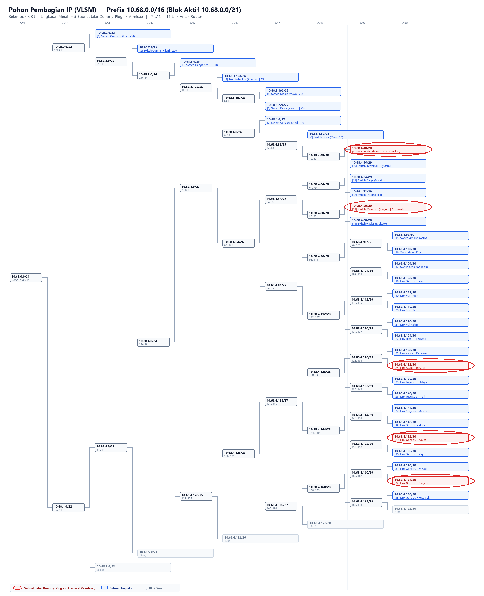
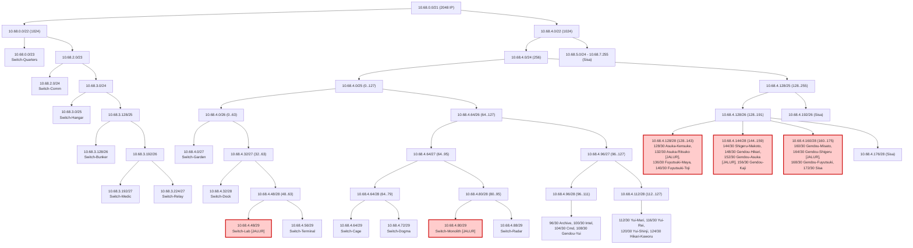
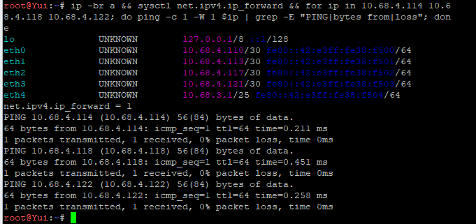
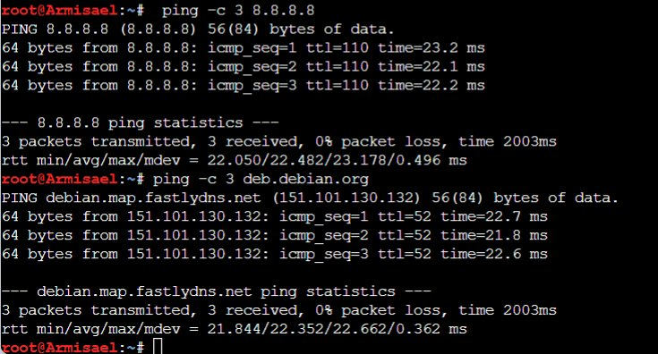
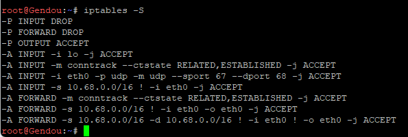
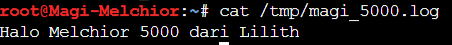
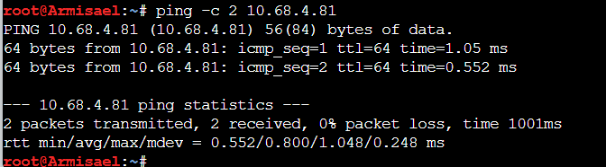
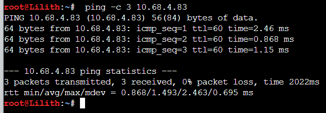
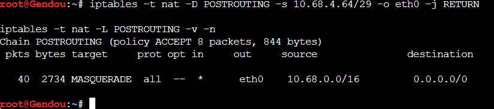
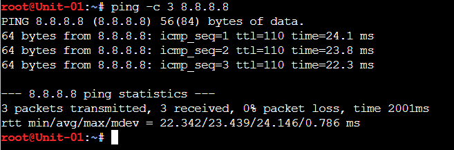

# Laporan Resmi Praktikum Modul 5 — Komunikasi Data & Jaringan Komputer 2026
## *Operation Geofront* (Soal 1 – Soal 10)

### Anggota Kelompok K-09
| Nama | NRP |
| :--- | :--- |
| Sultan Ahmad Maulana Bahyshidqi | `5027251070` |
| Muhammad Razzan Azizi Djuhari | `5027251086` |

- **Prefix IP Kelompok:** `10.68.0.0/16`
- **Image Docker:** `ardhptr21/debinet:latest`
- **Simulator:** GNS3

---

## Topologi Jaringan


Struktur direktori repositori:
- [`VLSM_Modul5_K09.xlsx`](VLSM_Modul5_K09.xlsx) — Spreadsheet lengkap VLSM (33 subnet dengan formula otomatis), daftar IP 25 host, mapping interface 17 router, dan tabel routing statis.
- [`assets/pohon_ip_vlsm.png`](assets/pohon_ip_vlsm.png) — Gambar pohon pembagian IP VLSM (5 subnet jalur `Dummy-Plug` → `Armisael` dilingkari).
- [`scripts/routers/`](scripts/routers/) — Script `/root/<nama>.sh` untuk seluruh 17 router (`gendo.sh`, `yui.sh`, `hikari.sh`, `asuka.sh`, `fuyutsuki.sh`, `shigeru.sh`, `mari.sh`, `rei.sh`, `shinji.sh`, `kaworu.sh`, `kensuke.sh`, `ritsuko.sh`, `kaji.sh`, `misato.sh`, `maya.sh`, `toji.sh`, `makoto.sh`).
- [`scripts/hosts/`](scripts/hosts/) — Script `/root/<nama>.sh` untuk layanan host (`casper.sh`, `balthasar.sh`, `melchior.sh`, `pen-pen.sh`, `tokyo3-core.sh`).
- [`configs/routers/`](configs/routers/) — Konfigurasi `/etc/network/interfaces` untuk 17 router.
- [`configs/hosts/`](configs/hosts/) — Konfigurasi `/etc/network/interfaces` permanen untuk 25 node non-router.

---

## Babak 1: Membangun Geofront

### Soal 1 — Pembagian IP (VLSM) & Pohon IP

Pembagian IP dari prefix `10.68.0.0/16` dilakukan dengan metode VLSM dari kebutuhan terbesar mengikuti aturan tie-break: **ukuran sama → LAN dulu daripada link → urutan tabel**. Setiap LAN memperhitungkan jumlah host ditambah **+1 IP gateway**.

#### Tabel VLSM (17 LAN + 16 Link Antar-Router)

| No | Subnet / Link | Ujung & Interface (`eth`) | Keb. (+GW) | Prefix | Network | Gateway / IP Router | Broadcast | Usable | Terpakai | Sisa |
| :-: | :--- | :--- | :-: | :-: | :--- | :--- | :--- | :-: | :-: | :-: |
| 1 | Switch-Quarters | Rei (`eth1`) | 501 | `/23` | `10.68.0.0` | `10.68.0.1` | `10.68.1.255` | 510 | 501 | 9 |
| 2 | Switch-Comm | Hikari (`eth2`) | 201 | `/24` | `10.68.2.0` | `10.68.2.1` | `10.68.2.255` | 254 | 201 | 53 |
| 3 | Switch-Hangar | Yui (`eth4`) | 101 | `/25` | `10.68.3.0` | `10.68.3.1` | `10.68.3.127` | 126 | 101 | 25 |
| 4 | Switch-Bunker | Kensuke (`eth1`) | 56 | `/26` | `10.68.3.128` | `10.68.3.129` | `10.68.3.191` | 62 | 56 | 6 |
| 5 | Switch-Medic | Maya (`eth1`) | 27 | `/27` | `10.68.3.192` | `10.68.3.193` | `10.68.3.223` | 30 | 27 | 3 |
| 6 | Switch-Relay | Kaworu (`eth1`) | 26 | `/27` | `10.68.3.224` | `10.68.3.225` | `10.68.3.255` | 30 | 26 | 4 |
| 7 | Switch-Garden | Shinji (`eth1`) | 15 | `/27` | `10.68.4.0` | `10.68.4.1` | `10.68.4.31` | 30 | 15 | 15 |
| 8 | Switch-Dock | Mari (`eth1`) | 13 | `/28` | `10.68.4.32` | `10.68.4.33` | `10.68.4.47` | 14 | 13 | 1 |
| 9 | **Switch-Lab** ⭐ | Ritsuko (`eth1`) | 6 | `/29` | `10.68.4.48` | `10.68.4.49` | `10.68.4.55` | 6 | 6 | 0 |
| 10 | Switch-Terminal | Fuyutsuki (`eth1`) | 4 | `/29` | `10.68.4.56` | `10.68.4.57` | `10.68.4.63` | 6 | 4 | 2 |
| 11 | Switch-Cage | Misato (`eth1`) | 4 | `/29` | `10.68.4.64` | `10.68.4.65` | `10.68.4.71` | 6 | 4 | 2 |
| 12 | Switch-Dogma | Toji (`eth1`) | 3 | `/29` | `10.68.4.72` | `10.68.4.73` | `10.68.4.79` | 6 | 3 | 3 |
| 13 | **Switch-Monolith** ⭐ | Shigeru (`eth1`) | 3 | `/29` | `10.68.4.80` | `10.68.4.81` | `10.68.4.87` | 6 | 3 | 3 |
| 14 | Switch-Radar | Makoto (`eth1`) | 5 | `/29` | `10.68.4.88` | `10.68.4.89` | `10.68.4.95` | 6 | 5 | 1 |
| 15 | Switch-Archive | Asuka (`eth3`) | 2 | `/30` | `10.68.4.96` | `10.68.4.97` | `10.68.4.99` | 2 | 2 | 0 |
| 16 | Switch-Intel | Kaji (`eth1`) | 2 | `/30` | `10.68.4.100` | `10.68.4.101` | `10.68.4.103` | 2 | 2 | 0 |
| 17 | Switch-Cmd | Gendou (`eth1`) | 2 | `/30` | `10.68.4.104` | `10.68.4.105` | `10.68.4.107` | 2 | 2 | 0 |
| 18 | Link Gendou–Yui | Gendou (`eth8`) – Yui (`eth0`) | 2 | `/30` | `10.68.4.108` | `.109` / `.110` | `10.68.4.111` | 2 | 2 | 0 |
| 19 | Link Yui–Mari | Yui (`eth1`) – Mari (`eth0`) | 2 | `/30` | `10.68.4.112` | `.113` / `.114` | `10.68.4.115` | 2 | 2 | 0 |
| 20 | Link Yui–Rei | Yui (`eth2`) – Rei (`eth0`) | 2 | `/30` | `10.68.4.116` | `.117` / `.118` | `10.68.4.119` | 2 | 2 | 0 |
| 21 | Link Yui–Shinji | Yui (`eth3`) – Shinji (`eth0`) | 2 | `/30` | `10.68.4.120` | `.121` / `.122` | `10.68.4.123` | 2 | 2 | 0 |
| 22 | Link Hikari–Kaworu | Hikari (`eth1`) – Kaworu (`eth0`) | 2 | `/30` | `10.68.4.124` | `.125` / `.126` | `10.68.4.127` | 2 | 2 | 0 |
| 23 | Link Asuka–Kensuke | Asuka (`eth1`) – Kensuke (`eth0`) | 2 | `/30` | `10.68.4.128` | `.129` / `.130` | `10.68.4.131` | 2 | 2 | 0 |
| 24 | **Link Asuka–Ritsuko** ⭐ | Asuka (`eth2`) – Ritsuko (`eth0`) | 2 | `/30` | `10.68.4.132` | `.133` / `.134` | `10.68.4.135` | 2 | 2 | 0 |
| 25 | Link Fuyutsuki–Maya | Fuyutsuki (`eth2`) – Maya (`eth0`) | 2 | `/30` | `10.68.4.136` | `.137` / `.138` | `10.68.4.139` | 2 | 2 | 0 |
| 26 | Link Fuyutsuki–Toji | Fuyutsuki (`eth3`) – Toji (`eth0`) | 2 | `/30` | `10.68.4.140` | `.141` / `.142` | `10.68.4.143` | 2 | 2 | 0 |
| 27 | Link Shigeru–Makoto | Shigeru (`eth2`) – Makoto (`eth0`) | 2 | `/30` | `10.68.4.144` | `.145` / `.146` | `10.68.4.147` | 2 | 2 | 0 |
| 28 | Link Gendou–Hikari | Gendou (`eth2`) – Hikari (`eth0`) | 2 | `/30` | `10.68.4.148` | `.149` / `.150` | `10.68.4.151` | 2 | 2 | 0 |
| 29 | **Link Gendou–Asuka** ⭐ | Gendou (`eth3`) – Asuka (`eth0`) | 2 | `/30` | `10.68.4.152` | `.153` / `.154` | `10.68.4.155` | 2 | 2 | 0 |
| 30 | Link Gendou–Kaji | Gendou (`eth4`) – Kaji (`eth0`) | 2 | `/30` | `10.68.4.156` | `.157` / `.158` | `10.68.4.159` | 2 | 2 | 0 |
| 31 | Link Gendou–Misato | Gendou (`eth5`) – Misato (`eth0`) | 2 | `/30` | `10.68.4.160` | `.161` / `.162` | `10.68.4.163` | 2 | 2 | 0 |
| 32 | **Link Gendou–Shigeru** ⭐ | Gendou (`eth6`) – Shigeru (`eth0`) | 2 | `/30` | `10.68.4.164` | `.165` / `.166` | `10.68.4.167` | 2 | 2 | 0 |
| 33 | Link Gendou–Fuyutsuki | Gendou (`eth7`) – Fuyutsuki (`eth0`) | 2 | `/30` | `10.68.4.168` | `.169` / `.170` | `10.68.4.171` | 2 | 2 | 0 |

#### Jalur Subnet `Dummy-Plug` → `Armisael` (ditandai ⭐)
1. `10.68.4.48/29` (`Switch-Lab` — Ritsuko)
2. `10.68.4.132/30` (Link `Asuka–Ritsuko`)
3. `10.68.4.152/30` (Link `Gendou–Asuka`)
4. `10.68.4.164/30` (Link `Gendou–Shigeru`)
5. `10.68.4.80/29` (`Switch-Monolith` — Shigeru)

#### Pohon Pembagian IP



<details>
<summary>Versi Diagram Mermaid</summary>



</details>

#### Penjelasan Hitungan Satu Subnet (`Switch-Garden`)
- `Garden-Staff` membutuhkan 14 host, ditambah 1 IP gateway (`Shinji`) sehingga total kebutuhan menjadi **15 IP usable**.
- Prefix `/28` hanya memiliki $2^{32-28} - 2 = 14$ IP usable (tidak cukup), maka dipilih prefix terkecil yang muat yaitu **`/27`** dengan ukuran blok $2^5 = 32$ IP dan $30$ IP usable.
- Subnet sebelumnya (`Switch-Relay`, `10.68.3.224/27`) berakhir di broadcast `10.68.3.255`, sehingga `Switch-Garden` dimulai pada network `10.68.4.0/27`, gateway `10.68.4.1`, host `10.68.4.2`, broadcast `10.68.4.31`, dan sisa $30 - 15 = 15$ IP.

---

### Soal 2 — Konfigurasi Interface Router & IP Forwarding

Seluruh 17 router diberi IP pada tiap interface sesuai hasil VLSM (tersimpan di [`configs/routers/`](configs/routers/)) dan `net.ipv4.ip_forward=1` diaktifkan di setiap router. Hanya `Gendou` (`eth0`) yang terhubung ke `NAT1` dan menerima IP via DHCP (`192.168.122.214/24`).

Bukti `ip -br a`, `ip_forward=1`, dan ping seluruh 16 link antar-router (diwakili 6 router induk yang mencakup seluruh 16 link):

| Gendou (7 Link) | Yui (3 Link) |
| :---: | :---: |
|  |  |

| Hikari (1 Link) | Asuka (2 Link) |
| :---: | :---: |
|  |  |

| Fuyutsuki (2 Link) | Shigeru (1 Link) |
| :---: | :---: |
|  |  |

---

### Soal 3 — Routing Statis & CIDR Summarization

Setiap router selain `Gendou` hanya memiliki 1 `default route` ke router atasnya dan rute spesifik ke subnet di bawahnya. Pada `Gendou` ([`scripts/routers/gendo.sh`](scripts/routers/gendo.sh)), 4 pasang subnet yang berada dalam satu cabang dan sejajar batas CIDR diringkas menjadi satu rute:
1. Cabang **Shigeru:** `10.68.4.80/29` + `10.68.4.88/29` → **`10.68.4.80/28`**
2. Cabang **Yui:** `10.68.4.112/30` + `10.68.4.116/30` → **`10.68.4.112/29`**
3. Cabang **Asuka:** `10.68.4.128/30` + `10.68.4.132/30` → **`10.68.4.128/29`**
4. Cabang **Fuyutsuki:** `10.68.4.136/30` + `10.68.4.140/30` → **`10.68.4.136/29`**

Bukti `Armisael` (`10.68.4.83`) berhasil ping ke `Lilith` (`10.68.4.74`), `Sachiel` (`10.68.3.130`), dan `Comm-Net` (`10.68.2.2`):


---

### Soal 4 — Akses Internet (NAT `MASQUERADE`) & Resolusi DNS

Pada `Gendou`, paket dari prefix internal (`10.68.0.0/16`) yang keluar lewat interface `NAT1` (`eth0`) diterjemahkan menggunakan `MASQUERADE` (dinamis mengikuti IP DHCP `eth0`), sehingga traffic antar-LAN tidak diterjemahkan dan tetap membawa IP asli:

```bash
iptables -t nat -A POSTROUTING -s 10.68.0.0/16 -o eth0 -j MASQUERADE
```

Resolusi DNS diarahkan ke `nameserver 8.8.8.8` pada `/etc/resolv.conf`.

| Ping `8.8.8.8` & `deb.debian.org` dari `Lilith` | Ping `8.8.8.8` & `deb.debian.org` dari `Armisael` |
| :---: | :---: |
|  |  |

Counter rule NAT `MASQUERADE` di `Gendou`:


---

### Soal 5 — Firewall Pintu Depan `Gendou`

Kebijakan `INPUT` dan `FORWARD` pada `Gendou` diubah menjadi `DROP`, lalu hanya mengizinkan loopback, koneksi `ESTABLISHED,RELATED`, DHCP dari `NAT1` (UDP `67 → 68`), traffic internal ke internet, traffic antar-LAN, dan traffic internal ke `Gendou` sendiri. Seluruh konfigurasi Soal 2–5 digabung idempoten dalam [`scripts/routers/gendo.sh`](scripts/routers/gendo.sh).

Output `iptables -S` di `Gendou`:



Pengujian ping `8.8.8.8` dari `Armisael` tetap berhasil setelah firewall aktif (lihat bukti di atas).

---

### Soal 6 — IP Statis Permanen Seluruh 25 Node Non-Router

Seluruh 25 container host non-router dikonfigurasi secara permanen melalui `/etc/network/interfaces` (lengkap di [`configs/hosts/`](configs/hosts/)) agar bertahan setelah restart.

Bukti `ip -br a` dan ping ke gateway (`10.68.4.65`) di `Unit-01` (`10.68.4.66/29`) setelah restart:


---

### Soal 7 — Membangunkan MAGI (`Casper`, `Balthasar`, `Melchior`)

Paket `iptables` dan `netcat-traditional` dipasang serta listener dinyalakan melalui script per-node ([`casper.sh`](scripts/hosts/casper.sh), [`balthasar.sh`](scripts/hosts/balthasar.sh), [`melchior.sh`](scripts/hosts/melchior.sh)) pada port TCP `5000` (ketiganya) dan TCP `5001` (`Magi-Balthasar`).

Bukti pesan yang dikirim dari `Lilith` diterima di tiap node MAGI:

| Magi-Casper (5000) | Magi-Melchior (5000) |
| :---: | :---: |
|  |  |

**Magi-Balthasar (5000 & 5001):**


---

### Soal 8 — Layanan Normal `Pen-Pen` & `Tokyo3-Core`

Layanan dijalankan melalui [`pen-pen.sh`](scripts/hosts/pen-pen.sh) (TCP 80 → `Welcome to Pen-Pen`) dan [`tokyo3-core.sh`](scripts/hosts/tokyo3-core.sh) (TCP 80 → `Welcome to Tokyo3-Core`, TCP 8080 → `syifa imutz`).

Bukti `nc` dari `Lilith` ke ketiga port tersebut dan pengujian port `22` yang langsung ditolak (`Connection refused` dalam `0.030s`, `exit=1`, tidak menggantung):


---

## Babak 2: Sabotase dan Hantu MAGI

### Soal 9 — Sabotase Routing di `Shigeru` (`break_routing.sh`)

#### Hasil Diagnostik & 4 Penyebab yang Ditemukan
Setelah menjalankan `break_routing.sh` di `Shigeru`, ditemukan **4 penyebab**:
1. **`net.ipv4.ip_forward = 0`** — kernel `Shigeru` berhenti meneruskan paket antar-interface.
2. **Default route salah arah** — `default via 10.68.4.146 dev eth2` membelokkan trafik keluar ke `Makoto`, bukan ke `Gendou` (`10.68.4.165 dev eth0`).
3. **Rute `blackhole 10.68.4.72/29`** — membuang seluruh paket menuju subnet `Switch-Dogma` (`Lilith`).
4. **Policy-Based Routing (`ip rule` + `table 100`)** — `90: from all iif eth1 lookup 100` dengan isi `table 100` berupa `unreachable default`, sehingga seluruh paket dari `eth1` (`Switch-Monolith`) langsung ditolak sebelum mencapai tabel `main`.

#### Kenapa Gejalanya Begitu?
- **`Armisael` tetap bisa ping gateway (`10.68.4.81`):** karena `10.68.4.81` milik `Shigeru` sendiri sehingga diproses pada `ip rule priority 0 (lookup local)` sebelum kena `priority 90`, dan tidak membutuhkan `ip_forward=1`.
- **`Lilith` tidak mendapat jawaban dari `Armisael`:** paket dari `Lilith` ke `Armisael` berhenti di `Shigeru` akibat `ip_forward=0`, dan paket balik dari `Armisael` (masuk via `eth1`) terhadang oleh `ip rule 90` (`table 100` → `unreachable`), `blackhole 10.68.4.72/29`, dan `default route` ke `Makoto`.

| Diagnostik 4 Penyebab di `Shigeru` | Gejala Sebelum Perbaikan |
| :---: | :---: |
|  | <br/> |

#### Perbaikan di `Shigeru`
```bash
sysctl -w net.ipv4.ip_forward=1
ip rule del iif eth1 lookup 100 priority 90
ip route flush table 100
ip route del blackhole 10.68.4.72/29
ip route replace default via 10.68.4.165 dev eth0
```

Bukti `Lilith` kembali bisa ping `Armisael` (`10.68.4.83`) setelah perbaikan:



---

### Soal 10 — Sabotase NAT di `Misato` & `Gendou` (`break_nat.sh`)

#### Hasil Diagnostik & 2 Penyebab yang Ditemukan
1. **Di `Misato` (`POSTROUTING` tabel `nat`):** terdapat rule `SNAT` yang menerjemahkan trafik dari `10.68.4.64/29` (`Switch-Cage`) dengan tujuan di luar `10.68.0.0/16` menjadi `172.31.99.1`. Saat sampai di `Gendou`, paket bersumber `172.31.99.1` ditolak oleh firewall `FORWARD` (yang hanya mengizinkan `-s 10.68.0.0/16`) dan juga tidak cocok dengan rule `MASQUERADE`.
2. **Di `Gendou` (`POSTROUTING` tabel `nat` baris 1):** disisipkan rule `RETURN` untuk `-s 10.68.4.64/29 -o eth0` tepat sebelum `MASQUERADE`. Akibatnya, meski SNAT di `Misato` dihapus, paket dari `Switch-Cage` tetap keluar ke `NAT1` tanpa diterjemahkan (masih memakai IP privat `10.68.4.66`) sehingga tidak mendapat balasan dari `8.8.8.8`.

#### Kenapa `Cage` Terdampak tapi `Intel` & Ping ke `Lilith` Tidak?
- **`Spy` (`Switch-Intel`, `10.68.4.100/30`) tidak terdampak** karena berada di bawah router `Kaji` (tidak melewati `Misato`), dan rule `RETURN` di `Gendou` hanya menargetkan `-s 10.68.4.64/29` (`Switch-Cage`), sehingga trafik `Spy` tetap lanjut ke rule `MASQUERADE`.
- **Ping dari `Cage` ke `Lilith` (`10.68.4.74`) tetap normal** karena rule SNAT di `Misato` memakai syarat `! -d 10.68.0.0/16` (tidak berlaku untuk tujuan internal) dan paket antar-LAN tidak keluar lewat `eth0` (`NAT1`).

#### Di Router Mana Alamat Sumber Diterjemahkan?
- **Sebelum perbaikan (sabotase):** alamat sumber paket `Cage` ke internet sempat diterjemahkan secara keliru di **`Misato`** menjadi `172.31.99.1`.
- **Setelah perbaikan (normal):** alamat sumber **hanya diterjemahkan di `Gendou`** melalui rule `MASQUERADE` pada chain `POSTROUTING` interface `eth0` (`NAT1`).

| Sebelum Perbaikan (`Misato`) | Sebelum Perbaikan (`Gendou`) |
| :---: | :---: |
|  |  |

#### Perbaikan di `Misato` & `Gendou`
```bash
# Di Misato:
iptables -t nat -F

# Di Gendou:
iptables -t nat -D POSTROUTING -s 10.68.4.64/29 -o eth0 -j RETURN
```

| Sesudah Perbaikan (`Misato`) | Sesudah Perbaikan (`Gendou`) |
| :---: | :---: |
|  |  |

Bukti `Unit-01` kembali bisa ping `8.8.8.8`:


