# Laporan Resmi Praktikum Modul 5 — Komunikasi Data & Jaringan Komputer 2026
## *Operation Geofront* (Soal 1 – Soal 10)

### Anggota Kelompok K-09
| Nama | NRP |
| :--- | :--- |
| Sultan Ahmad Maulana Bahyshidqi | `5027251070` |
| Muhammad Razzan Azizi Djuhari | `5027251086` |

- **Prefix IP Kelompok:** `10.68.0.0/16`
- **Image Docker:** `ardhptr21/debinet:latest`
- **Simulator:** GNS3

---

## Topologi Jaringan

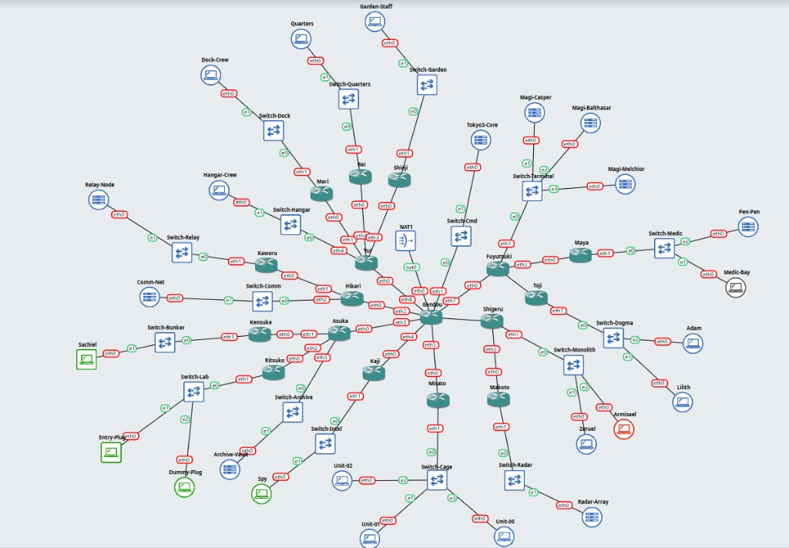

Struktur direktori repositori:
- [`VLSM_Modul5_K09.xlsx`](VLSM_Modul5_K09.xlsx) — Spreadsheet lengkap VLSM (33 subnet dengan formula otomatis), daftar IP 25 host, mapping interface 17 router, dan tabel routing statis.
- [`assets/pohon_ip_vlsm.png`](assets/pohon_ip_vlsm.png) — Gambar pohon pembagian IP VLSM (5 subnet jalur `Dummy-Plug` → `Armisael` dilingkari).
- [`scripts/routers/`](scripts/routers/) — Script `/root/<nama>.sh` untuk seluruh 17 router (`gendo.sh`, `yui.sh`, `hikari.sh`, `asuka.sh`, `fuyutsuki.sh`, `shigeru.sh`, `mari.sh`, `rei.sh`, `shinji.sh`, `kaworu.sh`, `kensuke.sh`, `ritsuko.sh`, `kaji.sh`, `misato.sh`, `maya.sh`, `toji.sh`, `makoto.sh`).
- [`scripts/hosts/`](scripts/hosts/) — Script `/root/<nama>.sh` untuk layanan host (`casper.sh`, `balthasar.sh`, `melchior.sh`, `pen-pen.sh`, `tokyo3-core.sh`).
- [`configs/routers/`](configs/routers/) — Konfigurasi `/etc/network/interfaces` untuk 17 router.
- [`configs/hosts/`](configs/hosts/) — Konfigurasi `/etc/network/interfaces` permanen untuk 25 node non-router.

---

## Babak 1: Membangun Geofront

### Soal 1 — Pembagian IP (VLSM) & Pohon IP

Pembagian IP dari prefix `10.68.0.0/16` dilakukan dengan metode VLSM dari kebutuhan terbesar mengikuti aturan tie-break: **ukuran sama → LAN dulu daripada link → urutan tabel**. Setiap LAN memperhitungkan jumlah host ditambah **+1 IP gateway**.

#### Tabel VLSM (17 LAN + 16 Link Antar-Router)

| No | Subnet / Link | Ujung & Interface (`eth`) | Keb. (+GW) | Prefix | Network | Gateway / IP Router | Broadcast | Usable | Terpakai | Sisa |
| :-: | :--- | :--- | :-: | :-: | :--- | :--- | :--- | :-: | :-: | :-: |
| 1 | Switch-Quarters | Rei (`eth1`) | 501 | `/23` | `10.68.0.0` | `10.68.0.1` | `10.68.1.255` | 510 | 501 | 9 |
| 2 | Switch-Comm | Hikari (`eth2`) | 201 | `/24` | `10.68.2.0` | `10.68.2.1` | `10.68.2.255` | 254 | 201 | 53 |
| 3 | Switch-Hangar | Yui (`eth4`) | 101 | `/25` | `10.68.3.0` | `10.68.3.1` | `10.68.3.127` | 126 | 101 | 25 |
| 4 | Switch-Bunker | Kensuke (`eth1`) | 56 | `/26` | `10.68.3.128` | `10.68.3.129` | `10.68.3.191` | 62 | 56 | 6 |
| 5 | Switch-Medic | Maya (`eth1`) | 27 | `/27` | `10.68.3.192` | `10.68.3.193` | `10.68.3.223` | 30 | 27 | 3 |
| 6 | Switch-Relay | Kaworu (`eth1`) | 26 | `/27` | `10.68.3.224` | `10.68.3.225` | `10.68.3.255` | 30 | 26 | 4 |
| 7 | Switch-Garden | Shinji (`eth1`) | 15 | `/27` | `10.68.4.0` | `10.68.4.1` | `10.68.4.31` | 30 | 15 | 15 |
| 8 | Switch-Dock | Mari (`eth1`) | 13 | `/28` | `10.68.4.32` | `10.68.4.33` | `10.68.4.47` | 14 | 13 | 1 |
| 9 | **Switch-Lab** ⭐ | Ritsuko (`eth1`) | 6 | `/29` | `10.68.4.48` | `10.68.4.49` | `10.68.4.55` | 6 | 6 | 0 |
| 10 | Switch-Terminal | Fuyutsuki (`eth1`) | 4 | `/29` | `10.68.4.56` | `10.68.4.57` | `10.68.4.63` | 6 | 4 | 2 |
| 11 | Switch-Cage | Misato (`eth1`) | 4 | `/29` | `10.68.4.64` | `10.68.4.65` | `10.68.4.71` | 6 | 4 | 2 |
| 12 | Switch-Dogma | Toji (`eth1`) | 3 | `/29` | `10.68.4.72` | `10.68.4.73` | `10.68.4.79` | 6 | 3 | 3 |
| 13 | **Switch-Monolith** ⭐ | Shigeru (`eth1`) | 3 | `/29` | `10.68.4.80` | `10.68.4.81` | `10.68.4.87` | 6 | 3 | 3 |
| 14 | Switch-Radar | Makoto (`eth1`) | 5 | `/29` | `10.68.4.88` | `10.68.4.89` | `10.68.4.95` | 6 | 5 | 1 |
| 15 | Switch-Archive | Asuka (`eth3`) | 2 | `/30` | `10.68.4.96` | `10.68.4.97` | `10.68.4.99` | 2 | 2 | 0 |
| 16 | Switch-Intel | Kaji (`eth1`) | 2 | `/30` | `10.68.4.100` | `10.68.4.101` | `10.68.4.103` | 2 | 2 | 0 |
| 17 | Switch-Cmd | Gendou (`eth1`) | 2 | `/30` | `10.68.4.104` | `10.68.4.105` | `10.68.4.107` | 2 | 2 | 0 |
| 18 | Link Gendou–Yui | Gendou (`eth8`) – Yui (`eth0`) | 2 | `/30` | `10.68.4.108` | `.109` / `.110` | `10.68.4.111` | 2 | 2 | 0 |
| 19 | Link Yui–Mari | Yui (`eth1`) – Mari (`eth0`) | 2 | `/30` | `10.68.4.112` | `.113` / `.114` | `10.68.4.115` | 2 | 2 | 0 |
| 20 | Link Yui–Rei | Yui (`eth2`) – Rei (`eth0`) | 2 | `/30` | `10.68.4.116` | `.117` / `.118` | `10.68.4.119` | 2 | 2 | 0 |
| 21 | Link Yui–Shinji | Yui (`eth3`) – Shinji (`eth0`) | 2 | `/30` | `10.68.4.120` | `.121` / `.122` | `10.68.4.123` | 2 | 2 | 0 |
| 22 | Link Hikari–Kaworu | Hikari (`eth1`) – Kaworu (`eth0`) | 2 | `/30` | `10.68.4.124` | `.125` / `.126` | `10.68.4.127` | 2 | 2 | 0 |
| 23 | Link Asuka–Kensuke | Asuka (`eth1`) – Kensuke (`eth0`) | 2 | `/30` | `10.68.4.128` | `.129` / `.130` | `10.68.4.131` | 2 | 2 | 0 |
| 24 | **Link Asuka–Ritsuko** ⭐ | Asuka (`eth2`) – Ritsuko (`eth0`) | 2 | `/30` | `10.68.4.132` | `.133` / `.134` | `10.68.4.135` | 2 | 2 | 0 |
| 25 | Link Fuyutsuki–Maya | Fuyutsuki (`eth2`) – Maya (`eth0`) | 2 | `/30` | `10.68.4.136` | `.137` / `.138` | `10.68.4.139` | 2 | 2 | 0 |
| 26 | Link Fuyutsuki–Toji | Fuyutsuki (`eth3`) – Toji (`eth0`) | 2 | `/30` | `10.68.4.140` | `.141` / `.142` | `10.68.4.143` | 2 | 2 | 0 |
| 27 | Link Shigeru–Makoto | Shigeru (`eth2`) – Makoto (`eth0`) | 2 | `/30` | `10.68.4.144` | `.145` / `.146` | `10.68.4.147` | 2 | 2 | 0 |
| 28 | Link Gendou–Hikari | Gendou (`eth2`) – Hikari (`eth0`) | 2 | `/30` | `10.68.4.148` | `.149` / `.150` | `10.68.4.151` | 2 | 2 | 0 |
| 29 | **Link Gendou–Asuka** ⭐ | Gendou (`eth3`) – Asuka (`eth0`) | 2 | `/30` | `10.68.4.152` | `.153` / `.154` | `10.68.4.155` | 2 | 2 | 0 |
| 30 | Link Gendou–Kaji | Gendou (`eth4`) – Kaji (`eth0`) | 2 | `/30` | `10.68.4.156` | `.157` / `.158` | `10.68.4.159` | 2 | 2 | 0 |
| 31 | Link Gendou–Misato | Gendou (`eth5`) – Misato (`eth0`) | 2 | `/30` | `10.68.4.160` | `.161` / `.162` | `10.68.4.163` | 2 | 2 | 0 |
| 32 | **Link Gendou–Shigeru** ⭐ | Gendou (`eth6`) – Shigeru (`eth0`) | 2 | `/30` | `10.68.4.164` | `.165` / `.166` | `10.68.4.167` | 2 | 2 | 0 |
| 33 | Link Gendou–Fuyutsuki | Gendou (`eth7`) – Fuyutsuki (`eth0`) | 2 | `/30` | `10.68.4.168` | `.169` / `.170` | `10.68.4.171` | 2 | 2 | 0 |

#### Jalur Subnet `Dummy-Plug` → `Armisael` (ditandai ⭐)
1. `10.68.4.48/29` (`Switch-Lab` — Ritsuko)
2. `10.68.4.132/30` (Link `Asuka–Ritsuko`)
3. `10.68.4.152/30` (Link `Gendou–Asuka`)
4. `10.68.4.164/30` (Link `Gendou–Shigeru`)
5. `10.68.4.80/29` (`Switch-Monolith` — Shigeru)

#### Pohon Pembagian IP


<details>
<summary>Versi Diagram Mermaid</summary>

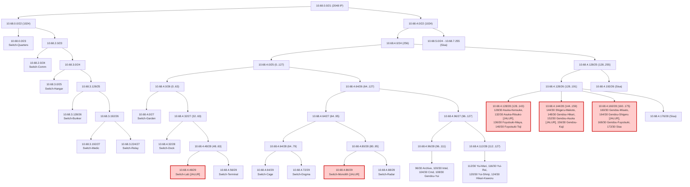

</details>

#### Penjelasan Hitungan Satu Subnet (`Switch-Garden`)
- `Garden-Staff` membutuhkan 14 host, ditambah 1 IP gateway (`Shinji`) sehingga total kebutuhan menjadi **15 IP usable**.
- Prefix `/28` hanya memiliki $2^{32-28} - 2 = 14$ IP usable (tidak cukup), maka dipilih prefix terkecil yang muat yaitu **`/27`** dengan ukuran blok $2^5 = 32$ IP dan $30$ IP usable.
- Subnet sebelumnya (`Switch-Relay`, `10.68.3.224/27`) berakhir di broadcast `10.68.3.255`, sehingga `Switch-Garden` dimulai pada network `10.68.4.0/27`, gateway `10.68.4.1`, host `10.68.4.2`, broadcast `10.68.4.31`, dan sisa $30 - 15 = 15$ IP.

---

### Soal 2 — Konfigurasi Interface Router & IP Forwarding

Seluruh 17 router diberi IP pada tiap interface sesuai hasil VLSM (tersimpan di [`configs/routers/`](configs/routers/)) dan `net.ipv4.ip_forward=1` diaktifkan di setiap router. Hanya `Gendou` (`eth0`) yang terhubung ke `NAT1` dan menerima IP via DHCP (`192.168.122.214/24`).

Bukti `ip -br a`, `ip_forward=1`, dan ping seluruh 16 link antar-router (diwakili 6 router induk yang mencakup seluruh 16 link):

| Gendou (7 Link) | Yui (3 Link) |
| :---: | :---: |
| 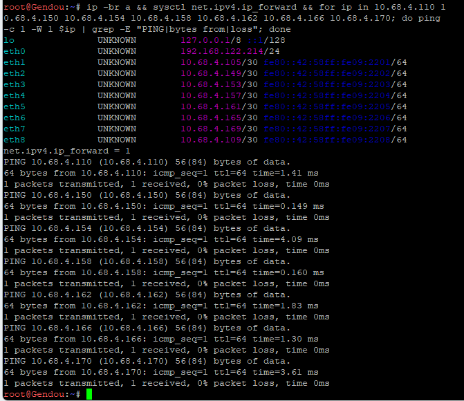 |  |

| Hikari (1 Link) | Asuka (2 Link) |
| :---: | :---: |
| 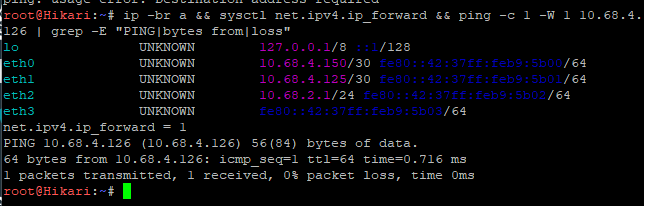 | 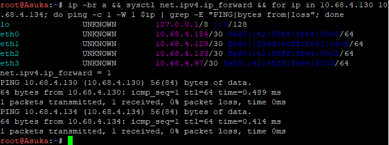 |

| Fuyutsuki (2 Link) | Shigeru (1 Link) |
| :---: | :---: |
| 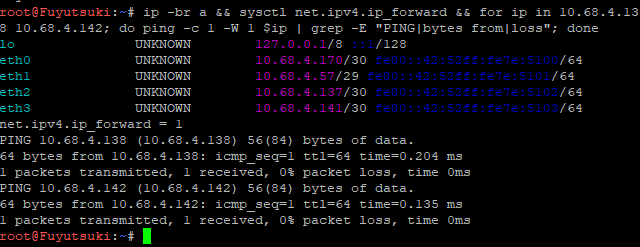 | 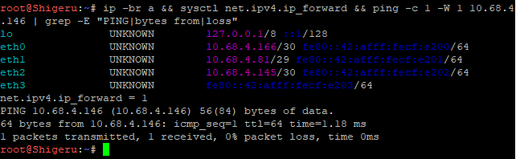 |

---

### Soal 3 — Routing Statis & CIDR Summarization

Setiap router selain `Gendou` hanya memiliki 1 `default route` ke router atasnya dan rute spesifik ke subnet di bawahnya. Pada `Gendou` ([`scripts/routers/gendo.sh`](scripts/routers/gendo.sh)), 4 pasang subnet yang berada dalam satu cabang dan sejajar batas CIDR diringkas menjadi satu rute:
1. Cabang **Shigeru:** `10.68.4.80/29` + `10.68.4.88/29` → **`10.68.4.80/28`**
2. Cabang **Yui:** `10.68.4.112/30` + `10.68.4.116/30` → **`10.68.4.112/29`**
3. Cabang **Asuka:** `10.68.4.128/30` + `10.68.4.132/30` → **`10.68.4.128/29`**
4. Cabang **Fuyutsuki:** `10.68.4.136/30` + `10.68.4.140/30` → **`10.68.4.136/29`**

Bukti `Armisael` (`10.68.4.83`) berhasil ping ke `Lilith` (`10.68.4.74`), `Sachiel` (`10.68.3.130`), dan `Comm-Net` (`10.68.2.2`):

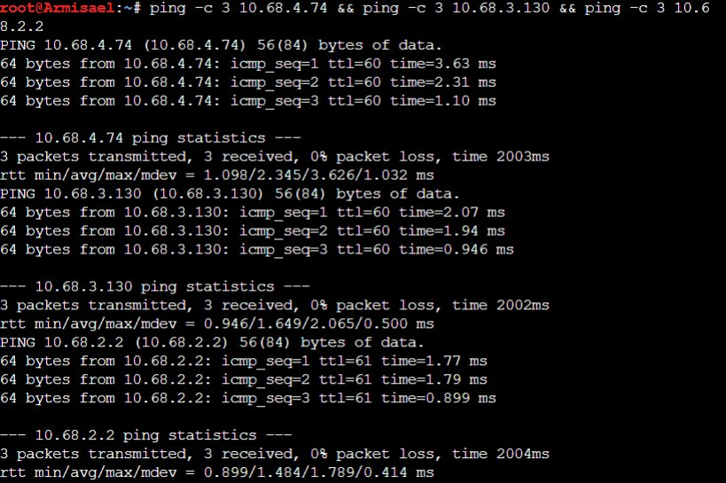

---

### Soal 4 — Akses Internet (NAT `MASQUERADE`) & Resolusi DNS

Pada `Gendou`, paket dari prefix internal (`10.68.0.0/16`) yang keluar lewat interface `NAT1` (`eth0`) diterjemahkan menggunakan `MASQUERADE` (dinamis mengikuti IP DHCP `eth0`), sehingga traffic antar-LAN tidak diterjemahkan dan tetap membawa IP asli:

```bash
iptables -t nat -A POSTROUTING -s 10.68.0.0/16 -o eth0 -j MASQUERADE
```

Resolusi DNS diarahkan ke `nameserver 8.8.8.8` pada `/etc/resolv.conf`.

| Ping `8.8.8.8` & `deb.debian.org` dari `Lilith` | Ping `8.8.8.8` & `deb.debian.org` dari `Armisael` |
| :---: | :---: |
| 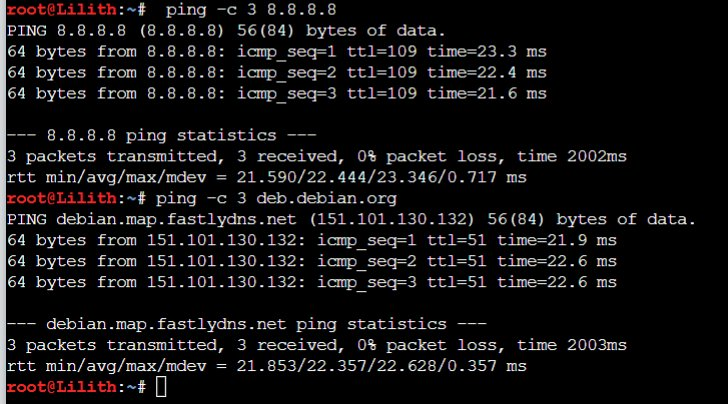 |  |

Counter rule NAT `MASQUERADE` di `Gendou`:

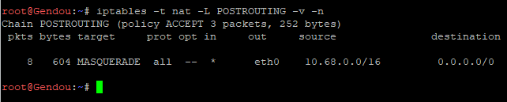

---

### Soal 5 — Firewall Pintu Depan `Gendou`

Kebijakan `INPUT` dan `FORWARD` pada `Gendou` diubah menjadi `DROP`, lalu hanya mengizinkan loopback, koneksi `ESTABLISHED,RELATED`, DHCP dari `NAT1` (UDP `67 → 68`), traffic internal ke internet, traffic antar-LAN, dan traffic internal ke `Gendou` sendiri. Seluruh konfigurasi Soal 2–5 digabung idempoten dalam [`scripts/routers/gendo.sh`](scripts/routers/gendo.sh).

Output `iptables -S` di `Gendou`:


Pengujian ping `8.8.8.8` dari `Armisael` tetap berhasil setelah firewall aktif (lihat bukti di atas).

---

### Soal 6 — IP Statis Permanen Seluruh 25 Node Non-Router

Seluruh 25 container host non-router dikonfigurasi secara permanen melalui `/etc/network/interfaces` (lengkap di [`configs/hosts/`](configs/hosts/)) agar bertahan setelah restart.

Bukti `ip -br a` dan ping ke gateway (`10.68.4.65`) di `Unit-01` (`10.68.4.66/29`) setelah restart:

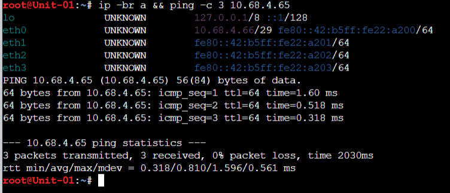

---

### Soal 7 — Membangunkan MAGI (`Casper`, `Balthasar`, `Melchior`)

Paket `iptables` dan `netcat-traditional` dipasang serta listener dinyalakan melalui script per-node ([`casper.sh`](scripts/hosts/casper.sh), [`balthasar.sh`](scripts/hosts/balthasar.sh), [`melchior.sh`](scripts/hosts/melchior.sh)) pada port TCP `5000` (ketiganya) dan TCP `5001` (`Magi-Balthasar`).

Bukti pesan yang dikirim dari `Lilith` diterima di tiap node MAGI:

| Magi-Casper (5000) | Magi-Melchior (5000) |
| :---: | :---: |
| 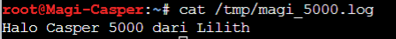 |  |

**Magi-Balthasar (5000 & 5001):**

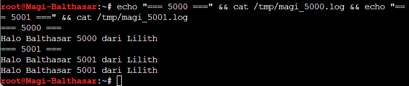

---

### Soal 8 — Layanan Normal `Pen-Pen` & `Tokyo3-Core`

Layanan dijalankan melalui [`pen-pen.sh`](scripts/hosts/pen-pen.sh) (TCP 80 → `Welcome to Pen-Pen`) dan [`tokyo3-core.sh`](scripts/hosts/tokyo3-core.sh) (TCP 80 → `Welcome to Tokyo3-Core`, TCP 8080 → `syifa imutz`).

Bukti `nc` dari `Lilith` ke ketiga port tersebut dan pengujian port `22` yang langsung ditolak (`Connection refused` dalam `0.030s`, `exit=1`, tidak menggantung):

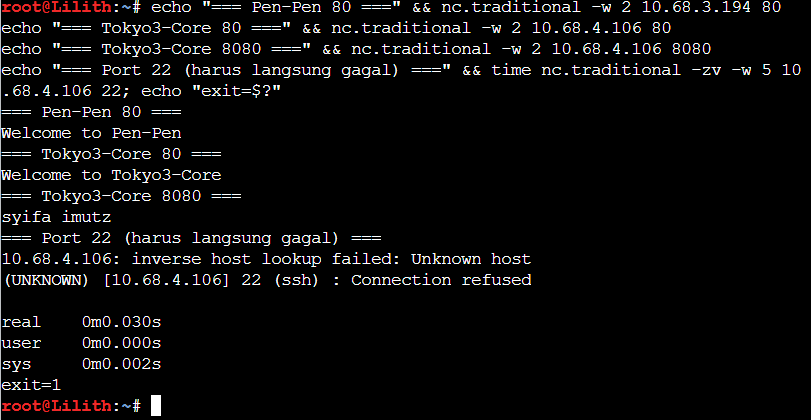

---

## Babak 2: Sabotase dan Hantu MAGI

### Soal 9 — Sabotase Routing di `Shigeru` (`break_routing.sh`)

#### Hasil Diagnostik & 4 Penyebab yang Ditemukan
Setelah menjalankan `break_routing.sh` di `Shigeru`, ditemukan **4 penyebab**:
1. **`net.ipv4.ip_forward = 0`** — kernel `Shigeru` berhenti meneruskan paket antar-interface.
2. **Default route salah arah** — `default via 10.68.4.146 dev eth2` membelokkan trafik keluar ke `Makoto`, bukan ke `Gendou` (`10.68.4.165 dev eth0`).
3. **Rute `blackhole 10.68.4.72/29`** — membuang seluruh paket menuju subnet `Switch-Dogma` (`Lilith`).
4. **Policy-Based Routing (`ip rule` + `table 100`)** — `90: from all iif eth1 lookup 100` dengan isi `table 100` berupa `unreachable default`, sehingga seluruh paket dari `eth1` (`Switch-Monolith`) langsung ditolak sebelum mencapai tabel `main`.

#### Kenapa Gejalanya Begitu?
- **`Armisael` tetap bisa ping gateway (`10.68.4.81`):** karena `10.68.4.81` milik `Shigeru` sendiri sehingga diproses pada `ip rule priority 0 (lookup local)` sebelum kena `priority 90`, dan tidak membutuhkan `ip_forward=1`.
- **`Lilith` tidak mendapat jawaban dari `Armisael`:** paket dari `Lilith` ke `Armisael` berhenti di `Shigeru` akibat `ip_forward=0`, dan paket balik dari `Armisael` (masuk via `eth1`) terhadang oleh `ip rule 90` (`table 100` → `unreachable`), `blackhole 10.68.4.72/29`, dan `default route` ke `Makoto`.

| Diagnostik 4 Penyebab di `Shigeru` | Gejala Sebelum Perbaikan |
| :---: | :---: |
| 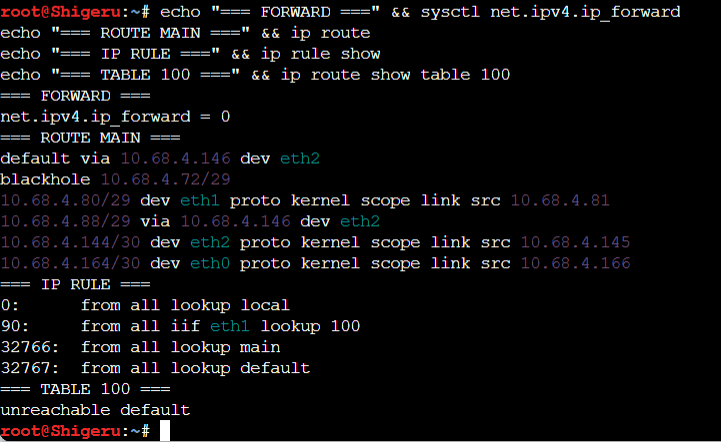 | <br/>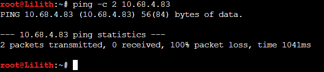 |

#### Perbaikan di `Shigeru`
```bash
sysctl -w net.ipv4.ip_forward=1
ip rule del iif eth1 lookup 100 priority 90
ip route flush table 100
ip route del blackhole 10.68.4.72/29
ip route replace default via 10.68.4.165 dev eth0
```

Bukti `Lilith` kembali bisa ping `Armisael` (`10.68.4.83`) setelah perbaikan:


---

### Soal 10 — Sabotase NAT di `Misato` & `Gendou` (`break_nat.sh`)

#### Hasil Diagnostik & 2 Penyebab yang Ditemukan
1. **Di `Misato` (`POSTROUTING` tabel `nat`):** terdapat rule `SNAT` yang menerjemahkan trafik dari `10.68.4.64/29` (`Switch-Cage`) dengan tujuan di luar `10.68.0.0/16` menjadi `172.31.99.1`. Saat sampai di `Gendou`, paket bersumber `172.31.99.1` ditolak oleh firewall `FORWARD` (yang hanya mengizinkan `-s 10.68.0.0/16`) dan juga tidak cocok dengan rule `MASQUERADE`.
2. **Di `Gendou` (`POSTROUTING` tabel `nat` baris 1):** disisipkan rule `RETURN` untuk `-s 10.68.4.64/29 -o eth0` tepat sebelum `MASQUERADE`. Akibatnya, meski SNAT di `Misato` dihapus, paket dari `Switch-Cage` tetap keluar ke `NAT1` tanpa diterjemahkan (masih memakai IP privat `10.68.4.66`) sehingga tidak mendapat balasan dari `8.8.8.8`.

#### Kenapa `Cage` Terdampak tapi `Intel` & Ping ke `Lilith` Tidak?
- **`Spy` (`Switch-Intel`, `10.68.4.100/30`) tidak terdampak** karena berada di bawah router `Kaji` (tidak melewati `Misato`), dan rule `RETURN` di `Gendou` hanya menargetkan `-s 10.68.4.64/29` (`Switch-Cage`), sehingga trafik `Spy` tetap lanjut ke rule `MASQUERADE`.
- **Ping dari `Cage` ke `Lilith` (`10.68.4.74`) tetap normal** karena rule SNAT di `Misato` memakai syarat `! -d 10.68.0.0/16` (tidak berlaku untuk tujuan internal) dan paket antar-LAN tidak keluar lewat `eth0` (`NAT1`).

#### Di Router Mana Alamat Sumber Diterjemahkan?
- **Sebelum perbaikan (sabotase):** alamat sumber paket `Cage` ke internet sempat diterjemahkan secara keliru di **`Misato`** menjadi `172.31.99.1`.
- **Setelah perbaikan (normal):** alamat sumber **hanya diterjemahkan di `Gendou`** melalui rule `MASQUERADE` pada chain `POSTROUTING` interface `eth0` (`NAT1`).

| Sebelum Perbaikan (`Misato`) | Sebelum Perbaikan (`Gendou`) |
| :---: | :---: |
| 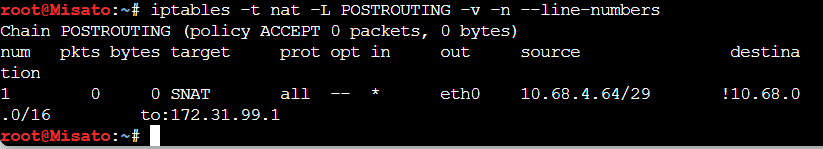 | 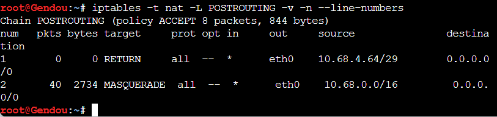 |

#### Perbaikan di `Misato` & `Gendou`
```bash
# Di Misato:
iptables -t nat -F

# Di Gendou:
iptables -t nat -D POSTROUTING -s 10.68.4.64/29 -o eth0 -j RETURN
```

| Sesudah Perbaikan (`Misato`) | Sesudah Perbaikan (`Gendou`) |
| :---: | :---: |
| 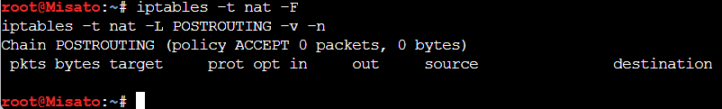 |  |

Bukti `Unit-01` kembali bisa ping `8.8.8.8`:


---

### Soal 11 — Memblokir Ping ke `Magi-Casper`

Pada `Magi-Casper` (`10.68.4.58`), paket ICMP dengan tipe `echo-request` yang masuk dibuang melalui chain `INPUT`. Rule dipasang langsung di Casper agar ping dari node satu switch juga ikut terblokir. ICMP `echo-reply` tidak diblokir sehingga Casper sendiri masih bisa melakukan ping keluar dan layanan TCP `5000` tetap berjalan.

```bash
iptables -A INPUT -p icmp --icmp-type echo-request -j DROP
```

Konfigurasi disimpan di [`scripts/hosts/soal11.sh`](scripts/hosts/soal11.sh).

| Ping dari `Magi-Balthasar` ke Casper | Ping dari `Lilith` ke Casper |
| :---: | :---: |
| 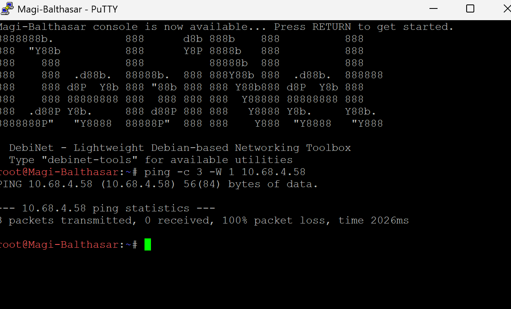 | 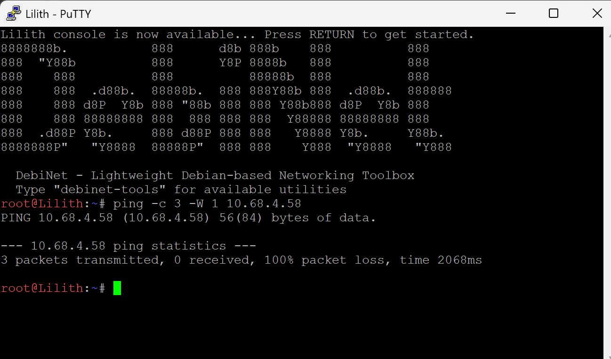 |

Bukti ping dari Casper ke `Magi-Balthasar` (`10.68.4.59`) dan `Lilith` (`10.68.4.74`) berhasil serta port `5000` masih dalam kondisi `LISTEN`:

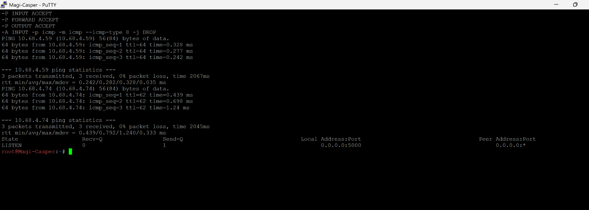

---

### Soal 12 — Sabotase Firewall di `Magi-Casper` (`break_fw.sh`)

#### Hasil Diagnostik & 3 Penyebab yang Ditemukan

Setelah menjalankan `break_fw.sh` di Casper, ditemukan 3 penyebab:
1. **Rule `INPUT -p icmp -j DROP`** — seluruh ICMP dibuang termasuk `echo-reply` dari `8.8.8.8`, sehingga ping keluar tidak mendapat balasan.
2. **Rule `OUTPUT -p udp --dport 53 -j DROP`** — query DNS lewat UDP port `53` diblokir, sehingga resolusi nama domain untuk kebutuhan APT terganggu.
3. **Policy `INPUT DROP` tanpa rule untuk `ESTABLISHED,RELATED` dan TCP `5000`** — balasan koneksi yang dimulai Casper ikut dibuang dan koneksi baru dari `Unit-00` ke port `5000` juga tidak diizinkan.

Default route Casper melalui `10.68.4.57` masih benar dan port `5000` masih `LISTEN`, sehingga penyebab pada Casper bukan karena listener mati atau gateway salah.

| Diagnostik Firewall Casper | `Unit-00` Sebelum Perbaikan |
| :---: | :---: |
| 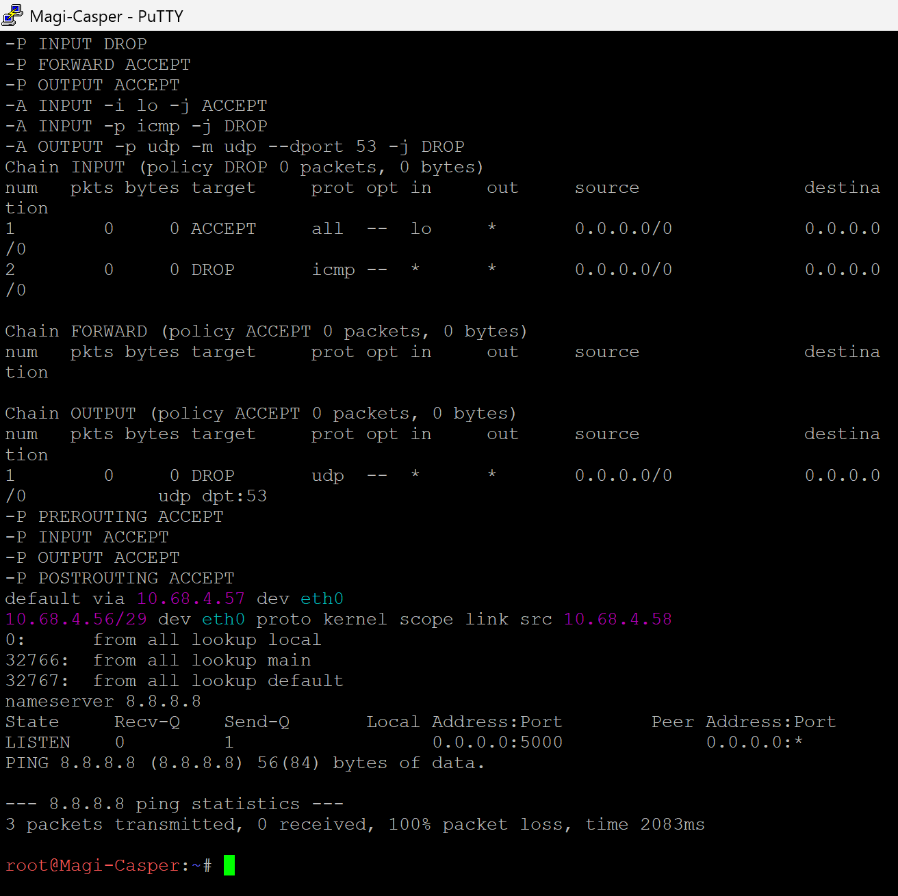 | 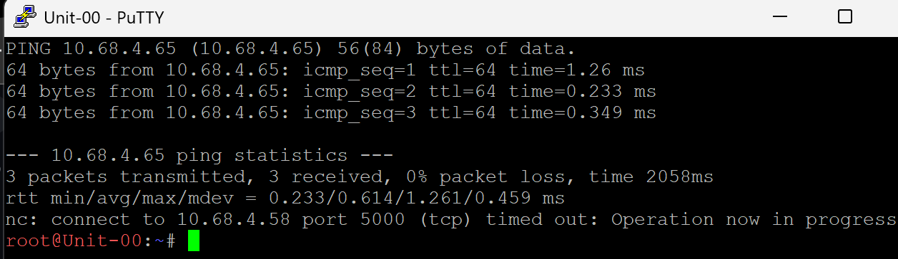 |

#### Perbaikan di `Magi-Casper`

```bash
iptables -D INPUT -p icmp -j DROP
iptables -D OUTPUT -p udp --dport 53 -j DROP
iptables -I INPUT 1 -m conntrack --ctstate ESTABLISHED,RELATED -j ACCEPT
iptables -I INPUT 1 -p icmp --icmp-type echo-request -j DROP
iptables -A INPUT -s 10.68.4.68 -p tcp --dport 5000 -j ACCEPT
```

Policy `INPUT DROP` tetap dipertahankan. Koneksi baru ke TCP `5000` hanya diizinkan dari `Unit-00` (`10.68.4.68`), sedangkan ping masuk tetap dibuang. Script perbaikan disimpan di [`scripts/hosts/soal12.sh`](scripts/hosts/soal12.sh).

| `Unit-00` Sesudah Perbaikan | Akses dari `Magi-Balthasar` |
| :---: | :---: |
| 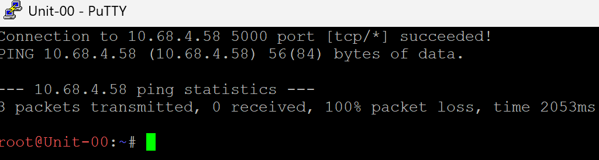 | 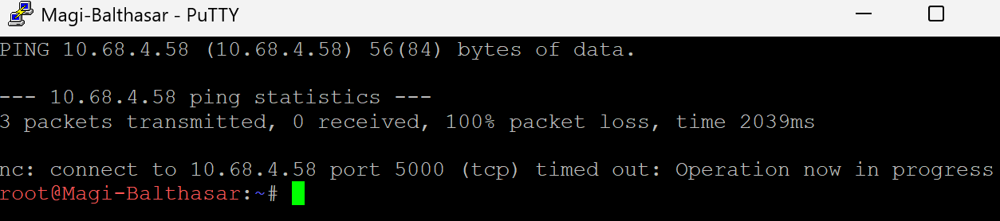 |

TCP `5000` dari Unit-00 berhasil, tetapi ping tetap gagal. Dari Balthasar, ping dan koneksi TCP `5000` sama-sama gagal.

Bukti rule firewall, counter, dan listener Casper sesudah perbaikan:

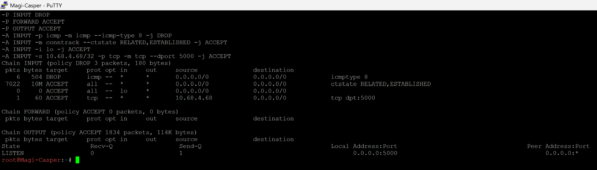

#### Pengujian Akses Internet

Ping `8.8.8.8` dari Casper kembali berhasil (0% packet loss) dan resolusi DNS ke `deb.debian.org` berjalan normal. APT dapat mengakses repository dan mengambil metadata, sementara verifikasi signature repository security belum tuntas.

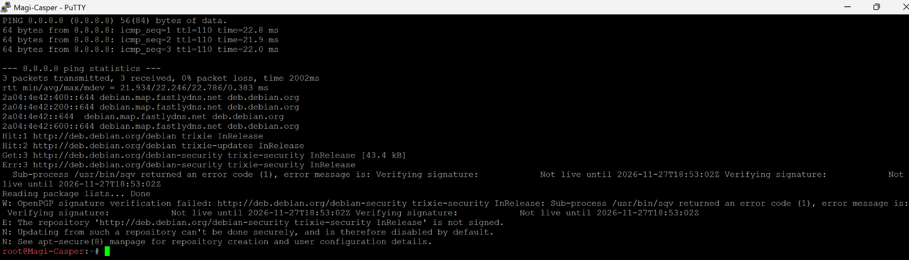

---

## Babak 3: Mengamankan MAGI dan Zona Sensitif

### Soal 13 — Pembatasan Akses TCP di `Magi-Balthasar`

Pada `Magi-Balthasar` (`10.68.4.59`) dibuat chain `BALTHASAR_ACCESS` yang hanya dilewati paket TCP dengan tujuan port `5000` dan `5001`. IP yang diizinkan adalah Casper (`10.68.4.58`) dan seluruh Pilot (`10.68.4.66`, `10.68.4.67`, `10.68.4.68`, `10.68.3.130`).

Paket dari IP lainnya ditolak menggunakan `REJECT --reject-with tcp-reset` agar koneksi langsung gagal (`Connection refused`), bukan menunggu timeout. Traffic di luar kedua port tersebut tidak melewati chain ini.

```bash
iptables -A BALTHASAR_ACCESS -p tcp -j REJECT --reject-with tcp-reset
iptables -I INPUT 1 -p tcp -m multiport --dports 5000,5001 -j BALTHASAR_ACCESS
```

Script lengkap: [`scripts/hosts/soal13.sh`](scripts/hosts/soal13.sh).

| `Unit-01` (5000 & 5001) | `Lilith` (5000 & 5001) |
| :---: | :---: |
| 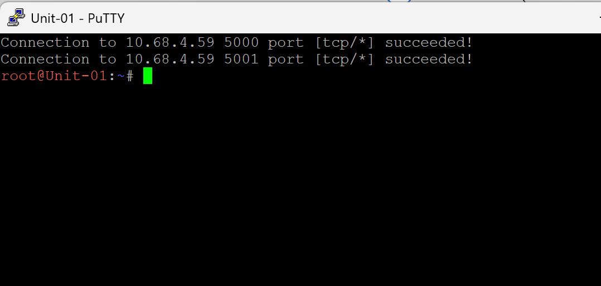 | 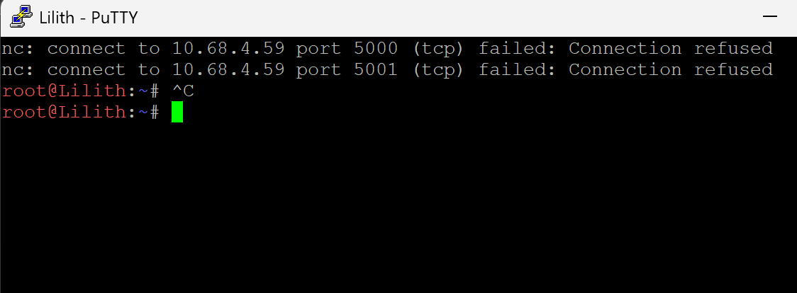 |

| `Magi-Melchior` (Satu Switch) | Counter & Ping Internet Balthasar |
| :---: | :---: |
| 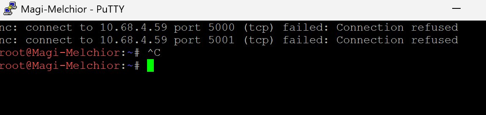 | 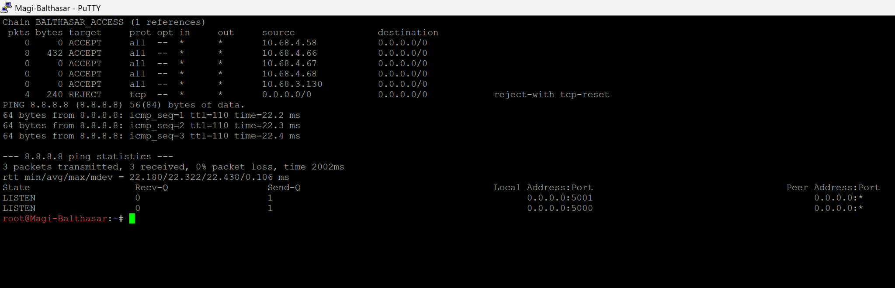 |

---

### Soal 14 — Pembatasan Jam Kunjungan `Pen-Pen`

Pada `Pen-Pen` (`10.68.3.194`) dibuat chain `PENPEN_TIME` untuk ICMP `echo-request` dan TCP port `80`. Pembatasan menggunakan modul `time` berdasarkan IP sumber. Untuk Pilot dan Staf, rule `ACCEPT` sesuai jadwal diletakkan sebelum rule `DROP` untuk IP yang sama. Terduga Dummy System selalu di-DROP dan node lainnya dikembalikan ke chain `INPUT` menggunakan `RETURN`.

#### Jadwal Kunjungan (WIB & UTC)

| Kelompok | Anggota | WIB | UTC |
| :--- | :--- | :--- | :--- |
| Pilot | Unit-01, Unit-02, Unit-00, Sachiel | 08.00–16.00 (Senin–Jumat) | 01.00–09.00 |
| Staf Geofront | Lilith, Adam | 17.00–23.00 (Setiap hari) | 10.00–16.00 |
| Terduga Dummy System | Dummy-Plug, Entry-Plug, Spy | Tidak pernah | Tidak pernah |
| Lainnya | Node di luar kategori di atas | Bebas | Bebas |

Variabel jadwal pada awal [`scripts/hosts/soal14.sh`](scripts/hosts/soal14.sh):

```bash
PILOT_START="${PILOT_START:-01:00:00}"
PILOT_STOP="${PILOT_STOP:-09:00:00}"
PILOT_DAYS="${PILOT_DAYS:-Mon,Tue,Wed,Thu,Fri}"
STAF_START="${STAF_START:-10:00:00}"
STAF_STOP="${STAF_STOP:-16:00:00}"
```

#### Pengujian A — Jadwal Staf Sesuai, Pilot Tidak Sesuai

Untuk pengujian pertama, jam Staf diperlebar menjadi `00:00:00–23:59:59 UTC`, sedangkan jadwal Pilot tetap seperti semula. Hasilnya `Lilith` berhasil, `Unit-01` gagal, dan `Spy` tetap gagal.

| `Unit-01` | `Lilith` |
| :---: | :---: |
| 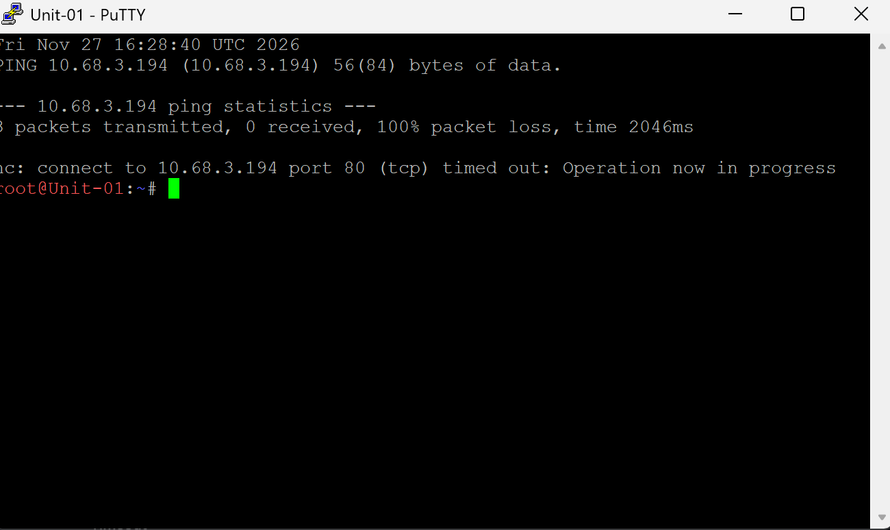 | 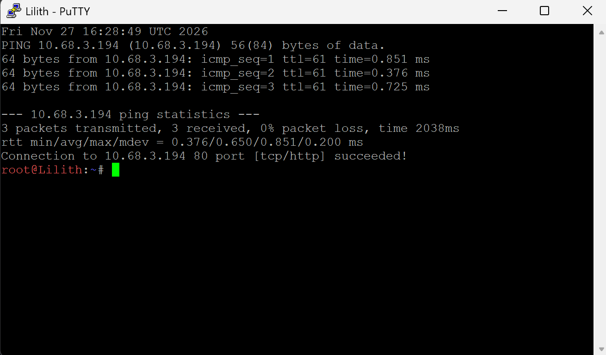 |

| `Spy` | Counter `PENPEN_TIME` |
| :---: | :---: |
| 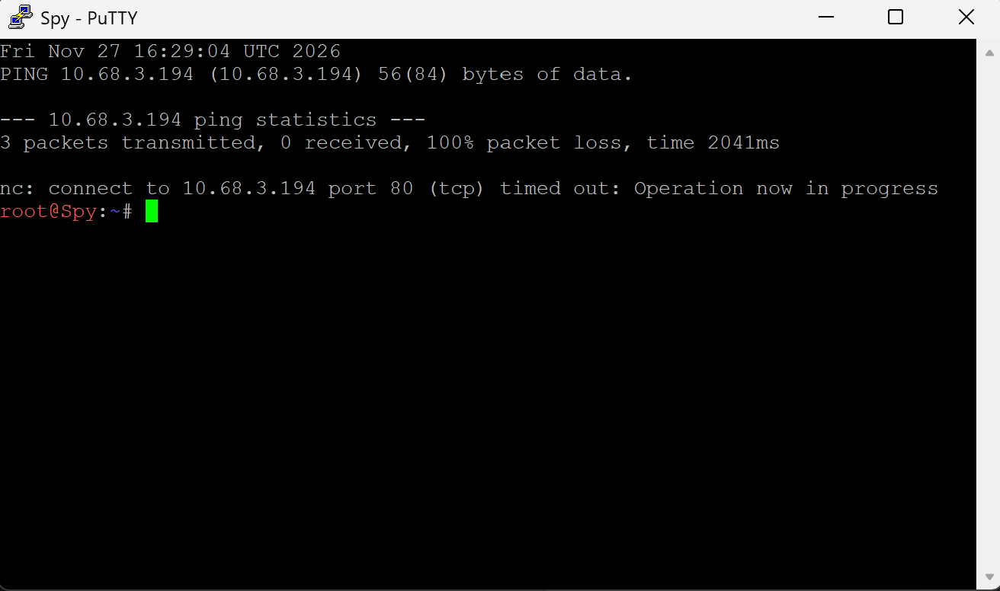 | 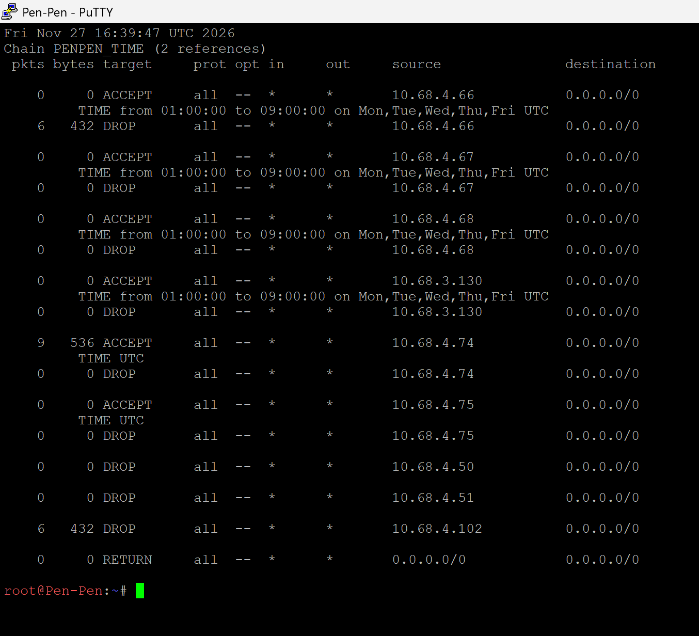 |

#### Pengujian B — Jadwal Pilot Sesuai, Staf Tidak Sesuai

Jam Pilot diubah menjadi `00:00:00–23:59:59 UTC` setiap hari dan jam Staf menjadi `01:00:00–02:00:00 UTC`. Hasilnya `Unit-01` berhasil, `Lilith` gagal, dan `Spy` tetap gagal.

| `Unit-01` | `Lilith` |
| :---: | :---: |
| 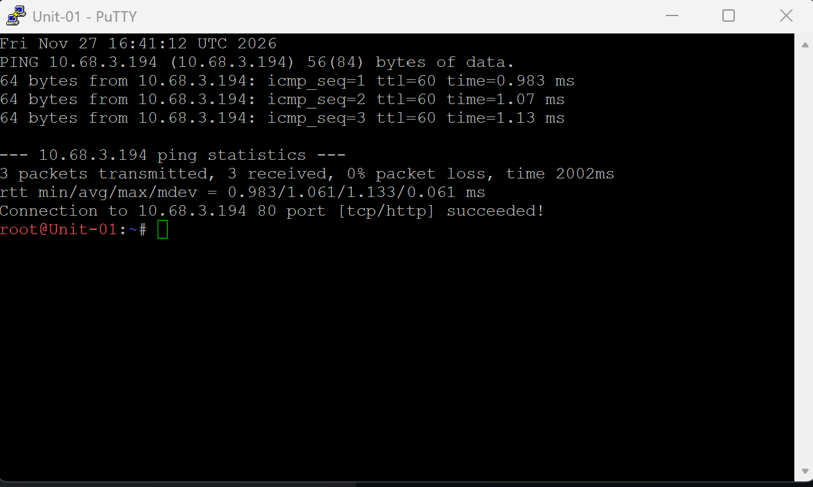 | 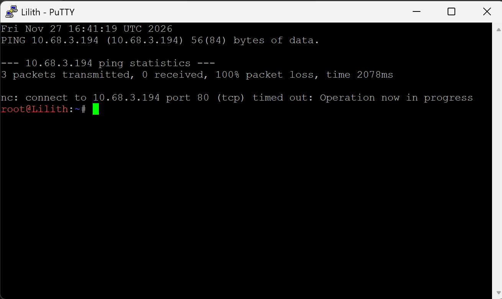 |

| `Spy` | Counter `PENPEN_TIME` |
| :---: | :---: |
| 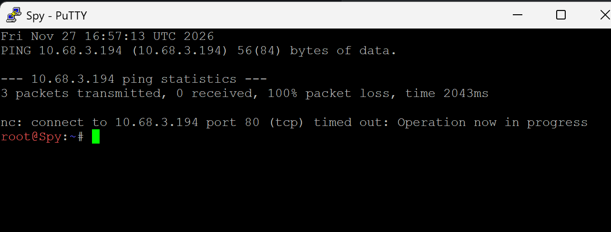 | 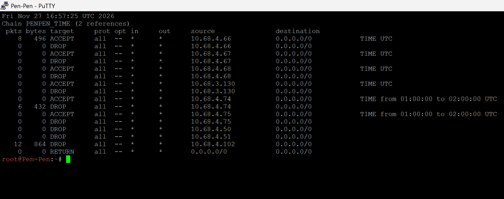 |

Setelah kedua pengujian selesai, script dijalankan kembali tanpa override variabel untuk mengembalikan jadwal awal.

---

### Soal 15 — Rate Limiting ICMP di `Tokyo3-Core`

Pada `Tokyo3-Core` (`10.68.4.106`) paket `echo-request` yang masuk diarahkan ke chain `ICMP_LIMIT` dengan modul `limit` sebesar `5/second` dan `limit-burst 1`. Paket yang melebihi batas dibuang oleh rule `DROP` di bawahnya. Rule tidak diterapkan pada `echo-reply` maupun chain `OUTPUT`, sehingga ping yang dilakukan Tokyo3-Core sendiri tidak ikut dibatasi.

```bash
iptables -N ICMP_LIMIT
iptables -A ICMP_LIMIT -m limit --limit 5/second --limit-burst 1 -j ACCEPT
iptables -A ICMP_LIMIT -j DROP
iptables -I INPUT 1 -p icmp --icmp-type echo-request -j ICMP_LIMIT
```

Script: [`scripts/hosts/soal15.sh`](scripts/hosts/soal15.sh).

Pengujian dari `Lilith` menggunakan `ping -i 0.1 -c 50` menghasilkan 25 paket diterima dan 25 paket hilang (50% packet loss). Counter chain menunjukkan masing-masing 25 paket pada rule `ACCEPT` dan `DROP`.

| Ping Rapat dari `Lilith` | Counter `ICMP_LIMIT` |
| :---: | :---: |
| 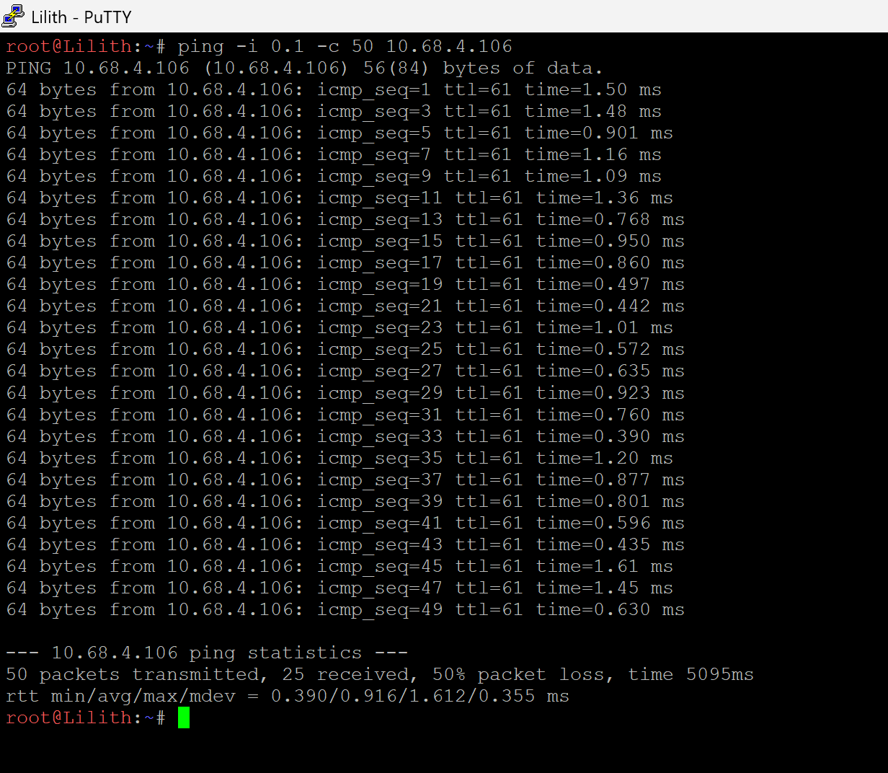 | 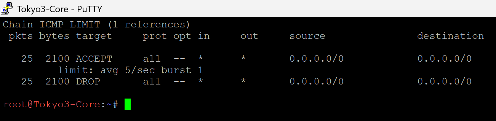 |

Pada pengujian ping biasa, 5 paket berhasil diterima seluruhnya (0% packet loss). Ping keluar dari Tokyo3-Core ke `Lilith` dan `8.8.8.8` juga berhasil.

| Ping Biasa dari `Lilith` | Ping Keluar & Listener Tokyo3-Core |
| :---: | :---: |
| 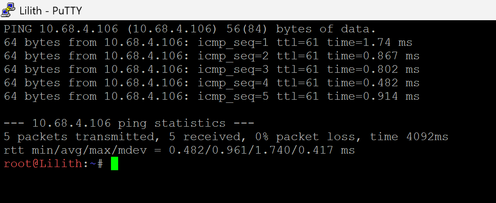 | 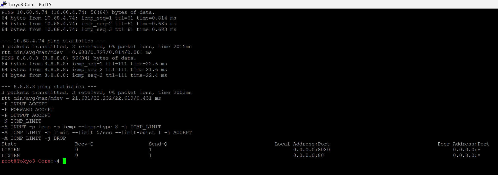 |

---

### Soal 16 — Logging & Penolakan Port Sensitif di `Tokyo3-Core`

Traffic TCP dari `Dummy-Plug` (`10.68.4.51`) yang menuju port `22`, `23`, atau `3306` diarahkan ke chain `SCAN_NERV`. Rule pertama mencatat paket dengan prefix `SCAN-NERV: `, kemudian rule kedua menolak koneksi dengan TCP reset. Port `80` dan `8080` tidak ikut diblokir.

```bash
iptables -N SCAN_NERV
iptables -A SCAN_NERV -j LOG --log-prefix "SCAN-NERV: "
iptables -A SCAN_NERV -p tcp -j REJECT --reject-with tcp-reset
iptables -I INPUT 1 -s 10.68.4.51 -p tcp -m multiport --dports 22,23,3306 -j SCAN_NERV
```

Script: [`scripts/hosts/soal16.sh`](scripts/hosts/soal16.sh). Chain `ICMP_LIMIT` dari soal 15 tetap dipertahankan.

| Pengujian `Dummy-Plug` | Pengujian `Lilith` |
| :---: | :---: |
| 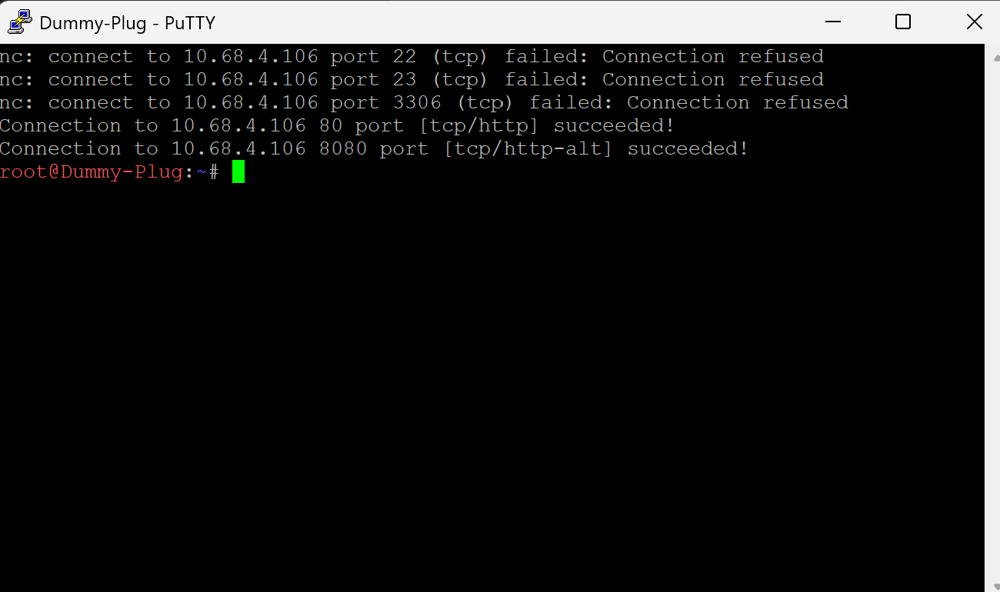 | 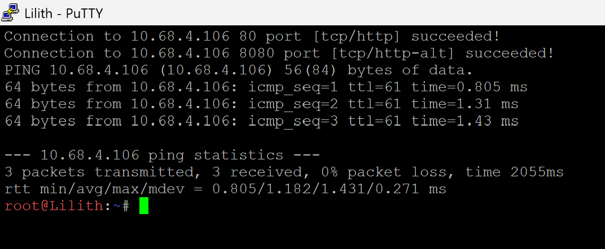 |

Ketiga port sensitif langsung menghasilkan `Connection refused` dari Dummy-Plug, sementara port `80` dan `8080` berhasil. Counter pada rule `LOG` dan `REJECT` masing-masing naik sebanyak 3 paket.

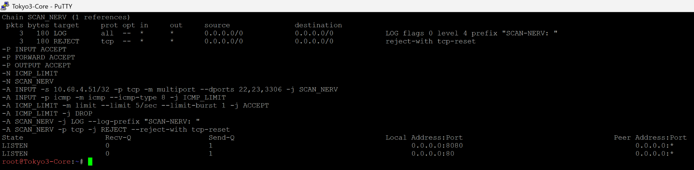

---

### Soal 17 — Pengalihan Koneksi TCP (DNAT) di `Fuyutsuki`

`Fuyutsuki` merupakan gateway dari Switch-Terminal. Pada chain `PREROUTING` tabel `nat` dipasang rule DNAT untuk semua TCP dari `Magi-Casper` (`10.68.4.58`) yang menuju `Zeruel` (`10.68.4.82`), sehingga IP tujuan diubah menjadi IP `Pen-Pen` (`10.68.3.194`). Port tujuan tetap sama dan ICMP tidak ikut dialihkan.

```bash
iptables -t nat -A PREROUTING -s 10.68.4.58 -d 10.68.4.82 -p tcp -j DNAT --to-destination 10.68.3.194
```

Script: [`scripts/routers/soal17.sh`](scripts/routers/soal17.sh).

#### Hasil Pengujian DNAT

Listener TCP `9000` dinyalakan di Pen-Pen dan Zeruel. Casper mengirim pesan `PESAN-CASPER-UNTUK-ZERUEL` ke IP Zeruel pada port `9000`. Pesan diterima oleh Pen-Pen, sementara log Zeruel tetap berukuran 0 byte meskipun listener-nya aktif.

| Pengujian dari `Magi-Casper` | Tabel `conntrack` Fuyutsuki |
| :---: | :---: |
| 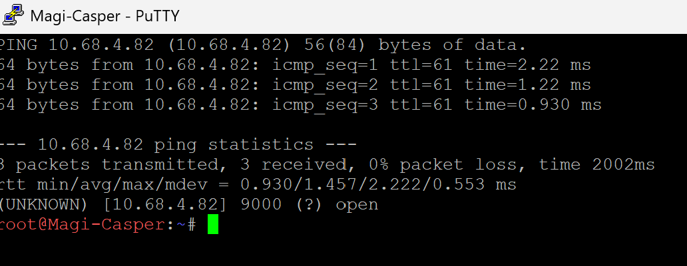 | 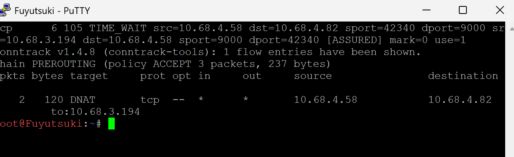 |

| Pesan Diterima `Pen-Pen` | Log `Zeruel` Kosong |
| :---: | :---: |
| 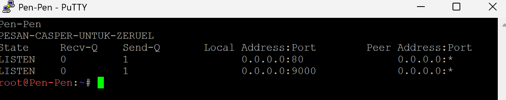 |  |

Pada tabel `conntrack`, koneksi awal tercatat dengan `src=10.68.4.58` dan `dst=10.68.4.82`, sedangkan arah balasannya berasal dari `10.68.3.194`. Karena paket balasan melewati Fuyutsuki kembali, conntrack melakukan translasi balik sehingga dari sisi Casper koneksi tetap terlihat menuju Zeruel. Ping Casper ke Zeruel tetap berhasil.

---

### Soal 18 — Stateful Firewall Zona Monolith & Radar di `Shigeru`

Subnet Monolith (`10.68.4.80/29`) dan Radar (`10.68.4.88/29`) dapat diringkas menjadi `10.68.4.80/28`. Pada `Shigeru`, paket `FORWARD` yang masuk dari sisi Gendou (`eth0`) dengan tujuan prefix tersebut diarahkan ke chain `ZONE_PROTECT`.

```bash
iptables -N ZONE_PROTECT
iptables -A ZONE_PROTECT -m conntrack --ctstate ESTABLISHED,RELATED -j ACCEPT
iptables -A ZONE_PROTECT -s 10.68.4.56/29 -p icmp --icmp-type echo-request -j ACCEPT
iptables -A ZONE_PROTECT -j DROP
iptables -I FORWARD 1 -i eth0 -d 10.68.4.80/28 -j ZONE_PROTECT
```

Balasan koneksi yang dimulai dari dalam zona diizinkan oleh `ESTABLISHED,RELATED`. Koneksi baru dari luar zona dibuang kecuali ping dari subnet Terminal (`10.68.4.56/29`). Dengan menggunakan interface `eth0`, subnet luar tidak perlu ditulis satu per satu.

Script: [`scripts/routers/soal18.sh`](scripts/routers/soal18.sh).

| Ping `Casper` ke `Zeruel` | Ping & TCP `Lilith` ke `Zeruel` |
| :---: | :---: |
|  |  |

| Akses Keluar dari Monolith (`Zeruel`) | Akses Keluar dari Radar (`Radar-Array`) |
| :---: | :---: |
|  |  |

Bukti counter ketiga rule di Shigeru:


---

### Soal 19 — Isolasi `Armisael` di Switch-Monolith

`Armisael` (`10.68.4.83`) dan `Zeruel` (`10.68.4.82`) berada pada subnet dan switch yang sama, sehingga paket antara keduanya tidak melewati router `Shigeru`. Pemblokiran menggunakan firewall router saja tidak cukup. Oleh karena itu isolasi dilakukan pada Layer 2 dengan memindahkan access port Armisael ke VLAN `99` yang tidak memiliki gateway maupun anggota lainnya.

| Port Switch-Monolith | Node | VLAN |
| :---: | :--- | :---: |
| `e0` | Shigeru | 1 |
| `e1` | Zeruel | 1 |
| `e2` | Armisael (`eth0`) | 99 |

| Mapping Port Switch | Konfigurasi VLAN |
| :---: | :---: |
|  |  |

Konfigurasi dilakukan melalui menu `Configure` pada Switch-Monolith. Setelah VLAN diubah, link Armisael disambungkan ulang pada port yang sama agar perubahan berlaku. Tidak ada perubahan IP maupun firewall di Armisael. Dokumentasi port disimpan di [`configs/soal19_switch-monolith.conf`](configs/soal19_switch-monolith.conf).

#### Hasil Pengujian Sebelum & Sesudah Isolasi

Listener TCP `9000` dijalankan pada Armisael, Zeruel, dan Lilith. Untuk pengujian ke Seele (`8.8.8.8`) digunakan TCP `53`.

| Sebelum Isolasi (`Armisael`) | Sesudah Isolasi (`Armisael`) |
| :---: | :---: |
|  |  |

Setelah isolasi, ping dan `nc` dari Armisael menuju Zeruel, Lilith, dan Seele gagal. Ping ke gateway sendiri (`10.68.4.81`) juga gagal. Dari Zeruel, koneksi ke Armisael gagal, tetapi ping dan `nc` ke Lilith dan Seele tetap berhasil.


---

## Babak Final: Siap Dihancurkan, Siap Dibangun Lagi

### Soal 20 — Backup, Restore & Idempotensi Konfigurasi

Tiga node yang dipilih yaitu `Gendou`, `Fuyutsuki`, dan `Shigeru`. Rule firewall disimpan menggunakan `iptables-save` ke `/root/<nama>.rules`, kemudian seluruh rule iptables termasuk tabel `nat` dihapus. Rute tambahan melalui gateway internal juga dihapus, sedangkan connected route dan default route DHCP pada Gendou tetap dipertahankan.

Pemulihan dilakukan dengan menjalankan kembali `/root/<nama>.sh` untuk routing dan `iptables-restore` untuk firewall. Proses tersebut dilakukan dua kali berturut-turut menggunakan [`scripts/routers/soal20.sh`](scripts/routers/soal20.sh). Hasil `iptables -S`, `iptables -t nat -S`, serta tabel routing dibandingkan menggunakan `diff`.

#### Hasil Restore Pertama & Kedua

| Router | Filter (1 / 2) | NAT (1 / 2) | Routing (1 / 2) |
| :--- | :---: | :---: | :---: |
| Gendou | 10 / 10 | 5 / 5 | 31 / 31 |
| Fuyutsuki | 3 / 3 | 5 / 5 | 7 / 7 |
| Shigeru | 8 / 8 | 4 / 4 | 5 / 5 |

Jumlah di atas merupakan jumlah baris output, bukan hanya jumlah rule. Tidak ada perbedaan antara restore pertama dan kedua maupun terhadap konfigurasi awal pada ketiga router.

| `Gendou` | `Fuyutsuki` |
| :---: | :---: |
|  |  |

Bukti penghapusan rule dan routing serta dua kali restore pada `Shigeru`:


#### Pengujian Konektivitas Setelah Pemulihan

Zeruel berhasil ping `8.8.8.8`, ping Lilith, dan `nc` ke Seele pada TCP `53`. Lilith masih bisa ping internet, tetapi ping dan `nc` menuju Zeruel diblokir sesuai firewall zona pada soal 18. Rule DNAT pada Fuyutsuki juga kembali tersedia setelah restore.

| `Zeruel` (Akses Keluar) | `Lilith` (Internet & Akses ke Zona) |
| :---: | :---: |
|  |  |

File backup firewall ketiga router:
- [`soal20_gendo.rules`](configs/backup/soal20_gendo.rules)
- [`soal20_fuyutsuki.rules`](configs/backup/soal20_fuyutsuki.rules)
- [`soal20_shigeru.rules`](configs/backup/soal20_shigeru.rules)
